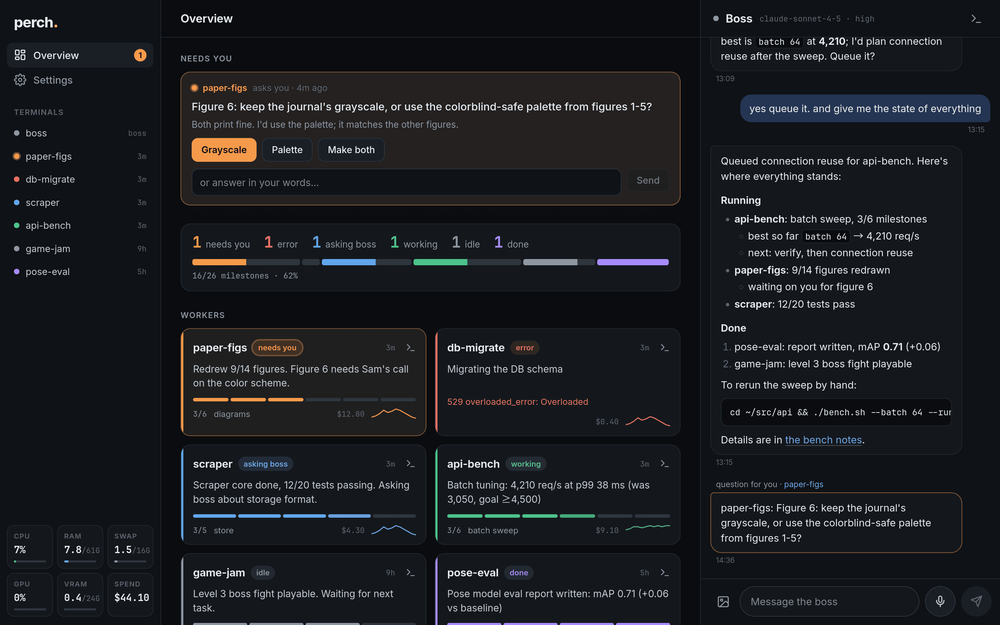
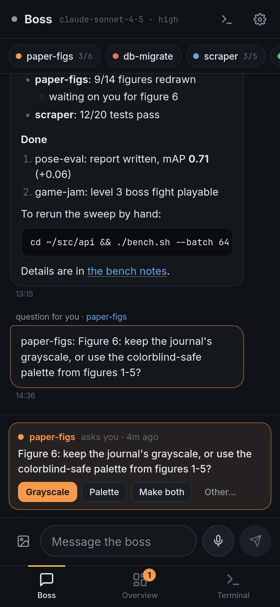
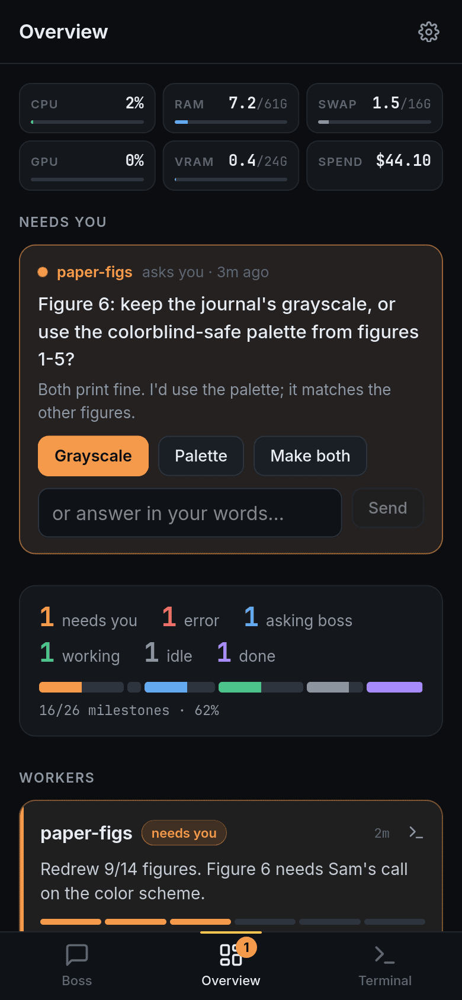

# Agent Perch

**v2, "perch": one boss, many workers, all [pi](https://pi.dev).** You talk to the boss; the boss runs the workers.

> v1 (tmux browser terminal for OpenCode, Codex, DeepSeek Harness, Pi): see tag/release [`v0.1.0`](https://github.com/invaliddayta/agent-perch/releases/tag/v0.1.0).
> Coming from it? See [upgrading from v1](#upgrading-from-v1).

perch turns [pi](https://github.com/earendil-works/pi), the coding agent, into a small team on your
own Linux machine. The boss is a pi that starts workers (more pis, each in its own tmux session),
gives them a brief, answers their questions, and asks you only what it can't decide. A dashboard,
built phone-first, shows every worker on one line, with the boss chat beside it and a browser
terminal for every tmux session.



<p align="center">

&nbsp;&nbsp;

</p>

- **Boss:** a pi in tmux session `boss`. Talk to it in the dashboard's chat (text, images, or your voice) or attach to it with `tmux attach -t boss`.
- **Workers:** one pi per tmux session. Each reports a one-line headline and a milestone plan, and asks the boss when it is stuck. You can attach to any worker and type; your words win over the boss's.
- **Dashboard:** what needs you, every worker at a glance, a 12-hour timeline, machine tiles (CPU, RAM, swap, GPU, spend), and browser terminals for every tmux session. It works on a phone and, over HTTPS, installs as an app.
- **Plain files:** everything lives in `~/.perch` as JSON and Markdown. No database, no extra LLM calls: the headlines come from the workers themselves.
- **Survives things:** agents keep running when the dashboard restarts. If a command eats the memory, only that command dies. After a reboot the boss comes back in its old conversation, and workers wait for you (or the boss) to resume them.

## Requirements

- **Linux with systemd** (a user manager, `systemctl --user`). perch uses systemd user units and gives every agent its own scope (`systemd-run --user --scope`) for memory limits. Tested on Arch Linux and Fedora 43. macOS and WSL without systemd are not supported.
- **[bun](https://bun.sh)** 1.2 or newer (tested with 1.3 and 1.4): `curl -fsSL https://bun.sh/install | bash`
- **tmux** 3.2 or newer (tested with 3.7 and 3.8), from your distribution.
- **[pi](https://pi.dev)** 1.1 or newer (tested with 1.4): `curl -fsSL https://pi.dev/install.sh | sh` (it needs Node.js 22.19 or newer; in a terminal it offers to install it). Start `pi` once and log in to a model provider with `/login` (or set an API key). perch uses whatever pi can use.
- **Optional: [Tailscale](https://tailscale.com)**, to open the dashboard from your phone and to get HTTPS, which browsers require for the microphone.
- **Optional: `nvidia-smi`** for the GPU tiles.

## Install

```sh
git clone https://github.com/invaliddayta/agent-perch.git ~/agent-perch
cd ~/agent-perch
bun bin/perch.ts install
```

`perch install` checks the requirements, installs the page's dependencies, and then:

1. puts a small loader into pi's extensions directory (`~/.pi/agent/extensions/perch.ts`), so every pi you start has perch, dormant until it gets a role;
2. writes two systemd user units, `perch-web` (the dashboard) and `perch-boss` (starts or resumes the boss), and enables and starts them.

It prints the address of the dashboard. That is your Tailscale IP if Tailscale runs, otherwise `http://127.0.0.1:4320/`. Options:

```sh
bun bin/perch.ts install --host 127.0.0.1    # where the dashboard listens (default: Tailscale IP, else 127.0.0.1)
bun bin/perch.ts install --port 4400         # default 4320
bun bin/perch.ts install --public-url https://box.example.ts.net/   # if a proxy puts it elsewhere (see HTTPS)
bun bin/perch.ts install --dry-run           # show the loader and the units, change nothing
```

The options are remembered in `~/.perch/install.json`, so a later `perch install` (after `git pull`) keeps them.

To keep perch running when you are logged out, and to start it at boot, turn on lingering once:

```sh
loginctl enable-linger $USER
```

For a shorter command, add `alias perch="bun ~/agent-perch/bin/perch.ts"` to your shell's rc file.

**Security:** perch has no login. Anyone who can open the dashboard can type into your terminals. Keep it on `127.0.0.1` or a private network such as your tailnet, never on a public address. `perch install` refuses to listen on all interfaces. Requests that change something, and terminals, must come from the dashboard's own page, so other websites open in your browser can't use it.

## First run

1. Open the dashboard. On a phone it opens on the boss chat; on a desktop the chat is docked on the right.
2. In **Settings**, check your name (the boss and the workers call you by it; the default is your account's first name), pick models and thinking levels for the boss and for workers (default: pi's own default), and the directory workers start in.
3. Tell the boss what you want, e.g. *"Start a worker that adds dark mode to ~/src/site, and one that profiles the API in ~/src/api."* The boss writes a brief for each worker and starts it. The workers appear in the overview with their headlines.
4. When the boss needs a decision from you, the question is pinned in the chat and on the overview, with answer buttons.

From a shell:

```sh
bun bin/perch.ts status            # one line per agent
bun bin/perch.ts say "hello"       # a chat message to the boss, as you
bun bin/perch.ts boss              # start or resume the boss if it isn't running
tmux attach -t boss                # the boss's own terminal; its widget lists the workers
```

Other tmux sessions show up in the overview too, each with a terminal. A pi you started yourself in tmux gets an **Adopt** button that makes it a worker, in place.

## Phone and HTTPS (Tailscale)

With Tailscale running, `perch install` binds the dashboard to your Tailscale IP (plus `127.0.0.1`), so any device in your tailnet can open `http://<tailscale-ip>:4320/`.

The microphone and the clipboard need HTTPS. perch gets a certificate from Tailscale by itself if you allow it once:

1. In the Tailscale admin console, under DNS, turn on MagicDNS and HTTPS certificates.
2. Let your user fetch certificates: `sudo tailscale set --operator=$USER`.

The same port then also serves `https://<machine>.<tailnet>.ts.net:4320/` (perch tells a TLS handshake from plain HTTP by its first byte). The certificate is kept in `~/.perch/tls` and renewed without a restart. On the phone, open that address and add it to the home screen.

For an address without a port, let `tailscale serve` proxy to perch's local listener and tell perch about it:

```sh
tailscale serve --bg --https=443 http://127.0.0.1:4320
bun bin/perch.ts install --public-url https://<machine>.<tailnet>.ts.net/
```

### Voice

The mic in the chat runs speech recognition on your device ([Moonshine](https://github.com/moonshine-ai/moonshine), English). The model (~300 MB) is not in the repository. Download it once:

```sh
bun scripts/prepare-voice.ts
```

## How it works

```
 phone / laptop browser
 ┌──────── perch web (bun, perch-web.service) ──────────────────────────┐
 │ overview · boss chat · terminals (xterm <-> tmux) · settings        │
 └──────────────────────────┬──────────────────────────────────────────┘
                            │ reads files, writes inbox messages
 ~/.perch/  settings.json, guidance.md, chat.jsonl, questions/, media/
   agents/<name>/  status.json, events.jsonl, brief.md, inbox/, session/, run.sh

 tmux "boss"   run.sh -> systemd scope -> pi + perch (role boss)     widget with workers
 tmux "<name>" run.sh -> systemd scope -> pi + perch (role worker)   attach any time
```

`ext/perch.ts` is one pi extension with three modes, picked by `PERCH_ROLE`:

| Mode | What it adds |
| --- | --- |
| `boss` | Tools: `workers`, `peek`, `tell` and `answer` (both pass images along), `ask_user`, `close_question`, `tell_user`, `spawn`, `resume`, `stop`, `end`. Writes the live worker table into its prompt and draws the worker widget. |
| `worker` | Tools: `report` (headline, milestones, finished) and `ask_boss`. Tells the boss when it stops, finishes or fails. |
| none (dormant) | Announces itself in `~/.perch/present/`, so the dashboard can adopt the session as a worker without a restart. |

Agents talk through plain files: status, events, inboxes, questions, chat, settings (see the top of `ext/store.ts`). The dashboard (`web/server.ts`) reads those files and writes inbox messages; it never talks to pi directly.

- **run.sh:** each agent has one in `~/.perch/agents/<name>/`. Running it again resumes the agent's conversation.
- **Memory:** `run.sh` starts pi in its own systemd scope with `OOMPolicy=continue` and the memory limit from Settings (default 50% of RAM). If a command eats the memory, the kernel kills that command and pi carries on.
- **Dead agents:** when an agent's pi disappears without shutting down, the dashboard marks it **dead** with the reason it can find (an OOM kill in the journal, pi's exit code, a reboot), tells the boss, and offers **Resume**. The worker continues its conversation and is told why it died.
- **Boot:** `perch-web` serves `127.0.0.1` at once and binds the Tailscale address as soon as it exists. `perch-boss` waits up to 3 minutes for the network, then resumes the boss. Workers are not restarted: they show as dead ("<machine> restarted") with Resume, and the boss is told. The tmux server and every pi have their own scopes, so restarting or stopping a unit kills no agent.
- **Terminals:** xterm.js over a PTY running `tmux attach` to a grouped viewer session per browser. A browser never squeezes someone else's view: it shows the window scaled down until you choose "Fit here". On a phone there is a key bar (Esc, Tab, Ctrl, arrows) and a line composer that keeps autocorrect and dictation.
- **Adopting a pi without perch:** the dashboard types `/reload` into it, but only when that pi is idle, its editor is empty and the pane is not in copy mode.
- **/reload** keeps an agent's role.

## Configuration

Most of it is in **Settings**: your name, models and thinking levels for the boss and the workers, per-worker models, the start directory, the memory limit, and the guidance the boss follows on when to ask you. Changes apply at each agent's next turn.

Environment variables, for the units (`perch install` sets the first four) or for running by hand:

| Variable | Default | |
| --- | --- | --- |
| `PERCH_HOME` | `~/.perch` | where everything is kept |
| `PERCH_HOST` | `127.0.0.1` | the dashboard's address |
| `PERCH_PORT` | `4320` | the dashboard's port |
| `PERCH_PUBLIC_URL` | | the address to send people to, if a proxy puts the dashboard elsewhere |
| `PERCH_LOCAL_PORT` | `PERCH_PORT` | with another `PERCH_HOST`, also serve `127.0.0.1` on this port (`off`: don't) |
| `PERCH_TLS` | | `off`: plain HTTP only |
| `PERCH_TLS_DOMAIN` | the tailnet name | the name to get a certificate for with `tailscale cert` |
| `PERCH_PI_ARGS` | | extra arguments for every agent's `pi` |
| `PERCH_TMUX_SOCKET` | tmux's default | run agents on another tmux server (`tmux -L <name>`) |
| `PI_CODING_AGENT_DIR` | `~/.pi/agent` | pi's own config directory; perch's loader goes into its `extensions/` |

## Update and uninstall

```sh
cd ~/agent-perch && git pull && bun bin/perch.ts install   # restarts the dashboard; agents keep running
bun bin/perch.ts runscripts                          # optional: rewrite every agent's run.sh with the new launcher
```

Running agents pick up a new perch extension at their next `/reload` or restart.

```sh
bun bin/perch.ts uninstall   # removes the units and the pi loader; agents keep running, ~/.perch stays
```

## Upgrading from v1

v1, the browser terminal for tmux sessions, lives on at tag/release [`v0.1.0`](https://github.com/invaliddayta/agent-perch/releases/tag/v0.1.0). v2 is a different product: a boss and workers on pi, with a dashboard (which still has browser terminals for every tmux session). Nothing carries over.

v1 ran as `agent-watch.service` on port 4310, v2 runs as `perch-web` and `perch-boss` on port 4320, so both can run side by side from separate checkouts. To replace v1: `systemctl --user disable --now agent-watch.service`, then `git pull` and `bun bin/perch.ts install` (v1's `.env` is not used).

## Costs

Every agent is a pi using your provider, and every turn costs what pi says it costs; the dashboard adds it up under Spend. The boss and idle workers cost nothing while nothing happens. perch makes no model calls of its own.

## Develop and test

```sh
./scripts/link-types.sh                          # node_modules -> pi's own (for type checking only)
(cd web && bun install)                          # the page's dependencies
npx -p typescript tsc -p .                       # typecheck the extension
(cd web && npx -p typescript tsc -p .)           # typecheck the page
```

To try changes without touching your running perch, use another home, tmux server and port:

```sh
export PERCH_HOME=/tmp/perch-seed PERCH_TMUX_SOCKET=perch-e2e
bun test/seed.ts                                 # fake workers, questions, chat and terminals
PERCH_PORT=4321 PERCH_TLS=off bun bin/perch.ts web
```

When perch is installed, `scripts/deploy.sh` runs your committed HEAD from a separate git worktree (`~/.perch/app`) and installs from there, so work in progress never runs live.

Tests (each uses a throwaway home under `/tmp` and its own tmux server, `tmux -L perch-e2e`; yours is never touched):

```sh
bun test/web-smoke.ts    # page, origin guard, a terminal over a websocket, sizing, history (no agents)
bun test/web-bind.ts     # the dashboard waits for an address that doesn't exist yet (boot)
bun test/e2e-sw.ts       # service worker: takes over from an older app, offline page (needs agent-browser)
bun test/e2e-worker.ts   # report, ask_boss, answer, finish, per-worker model from Settings
bun test/e2e-boss.ts     # you -> boss -> spawn -> worker question -> boss answers -> ask_user
bun test/e2e-adopt.ts    # a plain pi gets adopted in place
bun test/e2e-images.ts   # an image reaches the boss and a worker; a question answered in chat gets closed
bun test/e2e-oom.ts      # a command runs out of memory and pi survives; pi killed -> dead, Resume
bun test/e2e-reload.ts   # /reload keeps the role
bun test/e2e-reboot.ts   # simulated reboot with the perch-boss unit in a boot environment
```

The `e2e-*` tests run real pi agents on a cheap model: `anthropic/claude-haiku-4-5` by default, or pass `provider/model` as the first argument (or set `PERCH_TEST_MODEL`). A run costs a few cents. `e2e-worker` also switches a worker to a second model: `PERCH_TEST_MODEL2`, by default `anthropic/claude-sonnet-4-5` when testing with Haiku.

Notes:

- tmux `set-option`/`display-message` take a pane target: an exact session is `=name:` there, but `=name` for `has-session`/`kill-session`.
- Bun inlines CSS `url()` assets as base64, so the fonts are declared in `index.html` and copied by `web/build.ts`.

## Credits

The voice input comes from v1. The terminal font is a subset of [JetBrains Mono](https://github.com/JetBrains/JetBrainsMono) (Nerd Font build, SIL Open Font License, `web/src/fonts/OFL.txt`).

## License

MIT, see [LICENSE](LICENSE).
